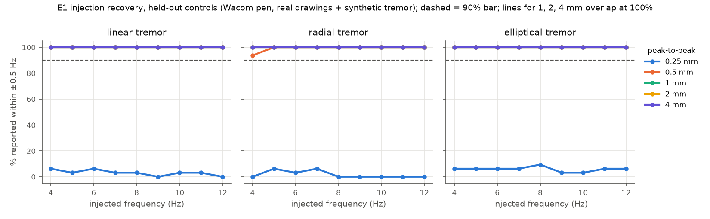

# Spiral Test

**Trace a spiral on your phone for about 15 seconds. Code measures your tremor in hertz and millimetres, refuses to guess when the drawing can't be trusted, and turns a week of drawings into a note your neurologist can read.**

Built for people with essential tremor who have just changed a dose and want to know, in numbers, whether it helped. Research prototype: **not a medical device, not for diagnosis.**

- **Try it:** _live link pending_ (static site, any phone browser, nothing to install). Open "Try it on a real recording" to run the pipeline on a real Parkinson's drawing.
- **Evaluation:** [`results/EVAL.md`](results/EVAL.md), regenerated by one command (below).



## The problem

About 7 million Americans have essential tremor, roughly 2.2% of the population ([Louis & Ottman 2014](https://pmc.ncbi.nlm.nih.gov/articles/PMC4137360)). After a dose change, a patient can usually only say "I think it's better," and the neurologist sees them months later. The spiral is already a standard clinical tremor test (it is an item on the TETRAS performance scale), but in clinic it's scored by eye.

## What it does

1. **Calibrate once.** Lay a bank card on the screen and match its outline (an ID-1 card is 85.60 mm wide). This turns screen pixels into millimetres without trusting the browser's reported pixel density.
2. **Trace the printed spiral** with one finger. Every pointer event is captured with its timestamp, including coalesced events.
3. **Quality gate.** The drawing is rejected, with the reason, if the screen delivered under 42 points/s, the trace paused or the finger lifted, it lasted under 8 s, it was drawn faster than 40 mm/s, under 85% of the spiral was traced, the trace didn't follow the template, or the clock jumped. A wrong number is worse than no number.
4. **Measure.** It reports peak-to-peak tremor amplitude in mm and the dominant frequency in Hz. When there's no clear rhythm, which is normal for a healthy hand, it says so instead of naming a frequency.
5. **Trend.** Each saved drawing gets context tags (dose timing, caffeine, sleep, alcohol). The app compares this week with last week and calls a change only when it exceeds the minimal detectable change. A plain-text note for the neurologist is built only from those numbers.

Everything runs on the phone. The analysis is the Python file [`spiral/metrics.py`](spiral/metrics.py), executed in the browser by [Pyodide](https://pyodide.org) with numpy, so **the code that runs on your phone is byte-for-byte the code the evaluation tests** (`tests/test_web_build.py` fails if they drift). Drawings never leave the device.

## Method

`spiral/metrics.py` (numpy only):

1. **Clean:** drop non-finite samples, collapse duplicate timestamps, and drop samples whose clock runs backwards. Samples are never sorted, because sorting created a fake 11 Hz peak on two real files (see EVAL.md).
2. **Resample** x(t) and y(t) to a uniform 100 Hz grid (linear interpolation).
3. **Band-pass** each axis 3.5–12 Hz. This is a zero-phase FFT filter with raised-cosine edges (2.5–3.5 Hz, 12–14 Hz) and odd-reflection padding; the first and last 0.5 s are trimmed. Filtering x and y separately makes the measure direction-invariant. A radial-only measure misses tremor along a fixed axis.
4. **Frequency:** a Welch spectrum (4 s Hann segments, 50% overlap) of x plus y. The peak is searched from 4 to 12 Hz with clamped parabolic sub-bin interpolation. A "dominant rhythm" needs a local maximum at least 9.5× the in-band median **and** an amplitude of at least 0.45 mm.
5. **Amplitude:** in 0.5 s windows, 2·√(2·λmax) of the 2-D residual covariance. That is 2A for a sinusoid of amplitude A along any axis, and the window follows the axis as it turns with the spiral. The reported value is the median over windows.
6. **Gate:** thresholds live in `metrics.GATE`, each set on the development split of the evaluation.

`spiral/trend.py` compares geometric-mean amplitudes (tremor size is roughly log-normal) between two weeks. A change counts only if it exceeds the larger of two thresholds: 1.96·√(SEM²/n₁+SEM²/n₂), with SEM taken from the person's own day-to-day spread, or the published single-drawing MDC of 51% ([Elble & Ellenbogen 2017](https://pmc.ncbi.nlm.nih.gov/articles/PMC5618112/)) scaled to a mean. Drawings are averaged per day first; it needs drawings on at least 3 days per week, and it warns when the two weeks were recorded at different sample rates.

`spiral/note.py` (laptop only, optional) can phrase the note with one Claude call. A number guard rejects any number, spelled-out number, percentage, ratio or unit that isn't in the metric table. After one failed retry it falls back to the deterministic template. The in-app note is always the deterministic template.

## Evaluation

Full tables, figures, threshold derivations and open issues are in [`results/EVAL.md`](results/EVAL.md).

**Data:** [UCI dataset 395](https://archive.ics.uci.edu/dataset/395), 77 people (15 controls, 62 with Parkinson's) drawing static and dynamic spirals with a pen on a Wacom Cintiq 12WX, 148 spiral recordings. **There is no essential tremor and no phone recording in it.** The dataset gives pixels, not millimetres, so every mm value on it assumes 0.204 mm/px. Hz values don't depend on that.

**Design:** a subject-level split, seeded and listed in EVAL.md: dev has 7 controls and 30 PD; held-out has 8 controls and 31 PD. Every threshold was chosen on dev, and every headline number below is held-out. Pass bars were written before building.

| Test (held-out) | Result | Pre-registered bar |
|---|---|---|
| Frequency recovery: real control drawings + injected tremor 4–12 Hz, ≥1 mm peak-to-peak, 3 geometries | ±0.5 Hz in **100%** of 2,592 trials | ≥90%: **pass** |
| Amplitude recovery, same trials | within ±25% in **100%** | ≥90%: **pass** |
| Same, after simulating iPhone-like 60 Hz sampling (±2 ms jitter, 0.16 mm quantisation) | **100% / 100%** of 864 | **pass** |
| 30, 24, 20 Hz sampling | amplitude fails (61%, 44%, 29%) | the gate abstains at all three |
| False "dominant rhythm" on un-injected healthy drawings | **0 / 16** | ≤5% |
| Baseline: radial-only method (Longardner-style), linear-axis tremor | amplitude ratio **0.99 vs 0.65** (frequency ties) | n/a |
| PD vs control, tremor amplitude, exploratory | AUC **0.82** (95% CI 0.66–0.95), n=39 | no bar; not diagnostic |
| Static vs dynamic spiral, same person | ICC(2,1) **0.93**; MDC95 104% | n/a; between-task, not test-retest |
| Mutation checks: break resampling, the band-pass, the rate gate | each turns a named check red | the band-edge rule's mutation stays green (reported) |

**What the injection test proves:** the pipeline recovers a known tremor from real human drawings. **What it doesn't prove:** that patient tremor, which isn't a clean sinusoid, behaves the same way, or that the app helps anyone. It is the strongest check possible without patients, and it is labelled that way everywhere.

**Where it fails or is untested:**
- Tremor smaller than 0.45 mm peak-to-peak is not called a rhythm: 4% detected at 0.25 mm.
- Fast drawing still leaks voluntary motion into the band (24% false rhythm on 2–3× sped-up controls that pass the gate).
- 41% of held-out Parkinson's drawings abstain, mostly because the pen lifted mid-spiral.
- **Essential tremor patients and real phones: untested.** The in-app Evidence page shows this as a failure map.

### Reproduce

```bash
uv sync
uv run python scripts/fetch_uci.py        # downloads UCI 395, verifies sha256
uv run python eval/run_eval.py            # ~70 s on 12 cores; seed 20261204; writes results/
uv run pytest -q                          # 144 tests
```

Real phone recordings: in the app, tap "Download raw drawing" after a test, put the files in `data/phone/<device>/`, and run `uv run python eval/eval_phone.py`. That reports the sample rate, gate pass rate and injected-tremor recovery per device. With no files it measures nothing and writes nothing.

### Run the app locally

```bash
uv run python scripts/build_web.py        # copies metrics.py/trend.py into web/py, exports demo drawings
python3 -m http.server 8000 --directory web
```

Open http://localhost:8000. For a phone on the same Wi-Fi, use the laptop's LAN IP. The analysis engine (Pyodide 0.28.3 + numpy, about 10 MB, cached after the first load) comes from cdn.jsdelivr.net.

CLI: `uv run spiral analyze <spiral-raw.json | UCI .txt> [--test 0]` and `uv run spiral note <history.json>`.

## Who benefits, and who could be harmed

**Benefits:** people with essential tremor adjusting medication (propranolol, primidone) who want an objective daily number between visits, and their neurologists, who get a dated trend in place of recall. It needs no wearable, no app store and no account.

**Could be harmed:**
- **Someone who reads a stable number as "my tremor is fine"** while it is getting worse in ways a spiral doesn't capture. Rest tremor, the Parkinson's hallmark, is largely missed by spiral drawing. The app never says anything about rest tremor or diagnosis.
- **Someone who changes their own dose** because of a trend. The note is for a clinician, the app gives no advice, and every change verdict states the threshold it had to beat.
- **Someone whose phone samples badly or whose drawing is fast.** The gate abstains instead of guessing, but it can't catch everything. Fast drawing is the measured weak spot.
- **People with small tremor (< 0.45 mm)** get "no dominant rhythm," which could falsely reassure. The amplitude is still reported.
- **Privacy:** health data stays in the browser's local storage. Export is the patient's decision.

## Limitations

- No essential tremor data and no real-phone data yet. Both are the next validation step.
- The UCI mm scale is assumed (0.204 mm/px).
- PD and control recordings in UCI use different tablet clocks (~111 vs ~143 Hz), which may inflate the exploratory AUC.
- The template gate threshold (1.8 mm) comes from synthetic traces only.
- Linear resampling softens fast tremor at low sample rates: an 11 Hz, 1 mm tremor reads 0.82 mm at 45 points/s and 0.97 mm at 120. The trend flags weeks recorded at different rates.
- With one allowed finger lift, the straight bridge across the lift still enters the spectrum. The median amplitude is unaffected, but the RMS drops slightly. Fix: per-stroke spectra.
- The change guard's SEM comes from the user's own data. The ceiling is a real phone test-retest study.
- Not FDA-cleared. Tremor monitoring can be a regulated device function (StrivePD went through 510(k)).

## With another month

1. **Real phones:** 10 volunteers × 3 drawings × 3 days on iPhone Safari and Android Chrome, for test-retest ICC and SEM on real devices and to fill the device rows of the failure map.
2. **Essential tremor:** recruit through a movement-disorders clinic or the IETF support community, with consent and drawings kept on-device, and compare against clinician TETRAS spiral ratings.
3. Replicate the Longardner et al. 2024 kinetic tremor magnitude on the same data as a second, published measure.
4. A shake/accelerometer cross-check, and a stylus mode.

## Attribution

- **Data:** Isenkul, M.E., Sakar, B.E., Kursun, O. (2014). *Parkinson Disease Spiral Drawings Using Digitized Graphics Tablet*, UCI Machine Learning Repository, dataset 395, CC BY 4.0. Seven drawings are bundled in `web/data/` with this attribution.
- **Runtime:** [Pyodide](https://pyodide.org) 0.28.3 (MPL-2.0) and [NumPy](https://numpy.org) (BSD-3). Fonts: Familjen Grotesk, IBM Plex Sans and IBM Plex Mono (SIL OFL), via Google Fonts.
- **Methods and figures referenced:** Elble & Ellenbogen 2017 (MDC); Longardner et al. 2024 (radial-error baseline); WebKit bug 261961 (iOS 60 Hz pointer cap); Louis & Ottman 2014 (prevalence).
- **Optional:** Anthropic Claude API (`claude-haiku-5-5`) for the laptop-only note phrasing; not used in the app.
- **AI tools:** built with Claude Code (Anthropic). Claude agents wrote most of the code, the evaluation harness and this README under the author's direction; the author reviewed, ran and is responsible for all of it.

## License

MIT, see [LICENSE](LICENSE).
