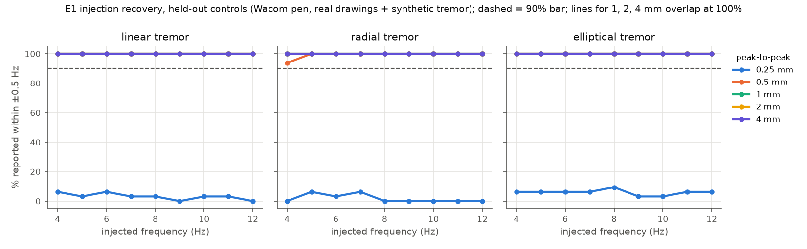
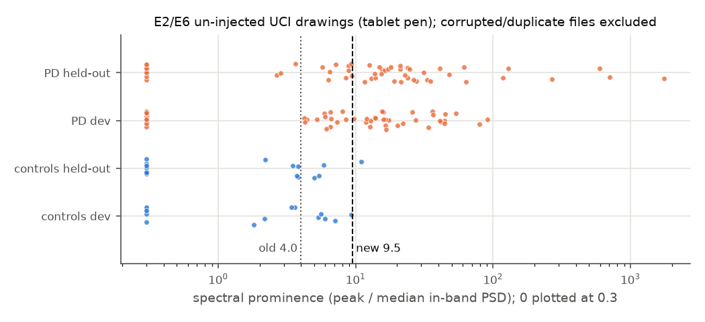
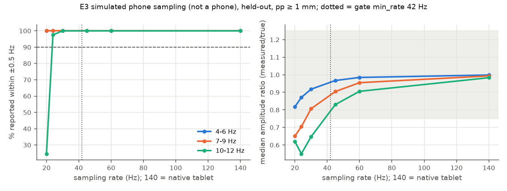
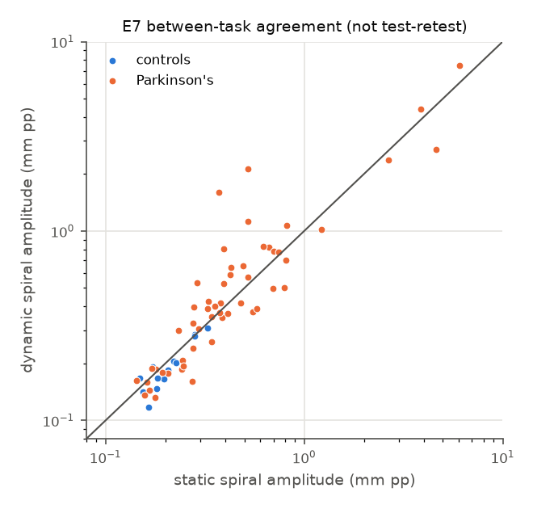

# Spiral Test — evaluation

Generated by `uv run python eval/run_eval.py` (seed 20261204, 18190 pipeline runs, 68.4 s). Do not edit by hand; rerun instead.

Data: UCI 395 (Isenkul et al. 2014), Wacom tablet + pen; 15 controls, 62 Parkinson's; no essential tremor, no phone recordings. Every mm value assumes 0.204 mm/px (no calibration in the dataset); frequencies and AUCs do not depend on it.

## Headline (held-out split)

- Injected 4–12 Hz tremor ≥1 mm pp on real control drawings: frequency reported within ±0.5 Hz in linear 100%, radial 100%, elliptical 100%. *n=2592, held-out; caveat: synthetic sinusoidal tremor on real tablet drawings; not patient tremor.*
- Amplitude within ±25% of truth (pp ≥1 mm): linear 100%, radial 100%, elliptical 100%. *n=2592, held-out; caveat: mm values assume 0.204 mm/px tablet scale.*
- False 'dominant rhythm' on un-injected healthy drawings: 0/16 (prominence ≥ 9.5 and amplitude ≥ 0.45 mm). *n=16, held-out; caveat: 8 control subjects; CI is wide.*
- Simulated 60 Hz phone sampling: ±0.5 Hz in 100%, amplitude ±25% in 100% (pp ≥1 mm). *n=864, held-out; caveat: simulated phone sampling, not a phone; finger/stylus on a real phone untested.*
- Linear-axis tremor vs a radial-only (Longardner-style) baseline: frequency ±0.5 Hz 100% vs 100%; amplitude ratio 0.99 vs 0.65. *n=864, held-out; caveat: advantage is amplitude, not frequency; same synthetic injections.*
- PD vs control, tremor amplitude AUC 0.82 (95% CI 0.66–0.95). *n=39, held-out; caveat: exploratory, 8 controls; device clock differs by group; not diagnostic.*
- Static vs dynamic spiral amplitude ICC(2,1) 0.93; MDC95 104% change. *n=35, held-out; caveat: between-task, not test-retest; Elble 2017 reports MDC 51% test-retest in ET.*
- Essential tremor, real phones: untested. *n=0, n/a; caveat: UCI has no ET patients and no phone recordings.*

## E0 Pre-registered split

- **control** dev (7): C_0001, C_0002, C_0004, C_0005, C_0008, C_0014, C_0015
- **control** held-out (8): C_0003, C_0006, C_0007, C_0009, C_0010, C_0011, C_0012, C_0013
- **parkinson** dev (30): H_P000-0001, H_P000-0002, H_P000-0007, H_P000-0008, H_P000-0012, H_P000-0013, H_P000-0016, H_P000-0019, H_P000-0022, H_P000-0023, H_P000-0024, H_P000-0029, H_P000-0030, H_P000-0032, H_P000-0037, H_P000-0039, H_P000-0040, H_p000-0018, P_02100001, P_05060003, P_11120004, P_11120005, P_23100002, P_23100003, P_26060001, P_26060002, P_26060007, P_27110001, P_27110003, P_30100002
- **parkinson** held-out (31): H_P000-0003, H_P000-0004, H_P000-0011, H_P000-0014, H_P000-0015, H_P000-0020, H_P000-0021, H_P000-0025, H_P000-0031, H_P000-0033, H_P000-0034, H_P000-0035, H_P000-0036, H_p000-0010, H_p000-0028, H_p000-0041, H_p000-0042, H_p000-0043, P_02100002, P_05060004, P_09100001, P_09100003, P_09100005, P_11120003, P_12060001, P_12060002, P_16100003, P_16100004, P_26060003, P_26060006, P_30100001

Split is by subject (both spiral tests of a subject stay together), seeded permutation of sorted IDs. Thresholds below were chosen on dev only. Whether `new_dataset` PD subjects overlap `hw_dataset` PD subjects is not documented; they are treated as distinct people.

## Threshold changes (set on dev)

| constant | old | new | rule / evidence |
|---|---|---|---|
| `MIN_PROMINENCE` | 4.0 | 9.5 | smallest value on a 0.25 grid with <=5% of dev un-injected control drawings at or above it. Dev control prominences (n=14): max 9.28, values ≥4: [5.36, 5.6, 6.01, 7.09, 9.28] |
| `GATE['min_rate_hz']` | 30.0 | 42.0 | lowest simulated rate at which both E1 bars hold on dev (and at every higher tested rate), x0.95 for timestamp noise in the measured rate. Validated rate 45.0 Hz. Dev bars (pp ≥1 mm): 60.0 Hz: freq 100%, amp 100%; 45.0 Hz: freq 100%, amp 100%; 30.0 Hz: freq 100%, amp 62%; 24.0 Hz: freq 99%, amp 43%; 20.0 Hz: freq 75%, amp 30% |
| `MIN_RHYTHM_PP_MM` (new constant) | 0.0 | 0.45 | 1.25 x the largest pp amplitude of any dev un-injected control drawing, rounded up to 0.05 mm (mm via the assumed 0.204 mm/px tablet scale). Largest dev control amplitude 0.326 mm. A dominant rhythm now needs prominence AND amplitude. |
| `GATE['max_speed_mm_s']` | 60.0 (first run of this eval: 30.0) | 40.0 | largest S such that dev false rhythm (prominence AND amplitude rules) among time-compressed un-injected control drawings passing every other gate check, with speed <= S' for every S' <= S, stays <= 5%; capped at the fastest such drawing; 5 mm/s grid. Dev cumulative false rhythm, last steps: ≤30: 0.0% (n=25); ≤35: 3.1% (n=32); ≤40: 2.8% (n=36); ≤45: 9.8% (n=41). Without the other-gates condition the rule gives 40.0. The first run's rule (20 mm/s windows of injected+un-injected trials, prominence rule only (rejected 51-57% of PD drawings; superseded on orchestrator instruction)) is superseded. |
| `GATE['max_template_dev_mm']` | 10.0 | 1.8 | 99th percentile of template_dev on synthetic honest dev traces, rounded up to 0.1 mm. SYNTHETIC ONLY: no UCI drawing has a template; untested on real phone drawings. See E10. |
| `GATE['max_clock_backsteps']` (new) | — | 0 | Any sample stamped >0.5 ms before an earlier one means the clock jumped; `clean()` no longer sorts (see the 11 Hz finding). |

`spiral/metrics.py` currently holds MIN_PROMINENCE=9.5, MIN_RHYTHM_PP_MM=0.45, min_rate_hz=42.0, max_speed_mm_s=40.0 → matches the dev-derived values. All held-out numbers in this file use the dev-derived values.

## E10 Template gate (synthetic traces only — untested on real phone drawings)

`template_deviation` used to measure distance to the *nearest* arm, which is capped at half the arm pitch (≈4.3 mm on the phone template) while the threshold was 10 mm, so `off_template` could never fire. It now follows the trace's own unwrapped angle: the first point fixes the start (any arm), and the expected radius grows by b per radian traced; it is computed on the low-passed path so tremor does not count. synthetic phone-like traces over the phone template (a=4 mm, b=26/(6 pi) mm/rad, 3 turns): honest = template + constant offset U(-1,1) mm + slow radial wander SD U(0,1.5) mm (<0.6 Hz) + tremor pp U(0,4) mm at U(4,12) Hz, 15% traced from the outer end; 60 Hz, +-2 ms jitter, 0.16 mm quantisation. The honest-trace error model is an assumption, not measured on people.

| split | trace kind | n | median dev mm | p99 dev mm | off_template % (new) | any template gate % | off_template % (old nearest-arm, 10 mm) |
|---|---|---|---|---|---|---|---|
| heldout | honest | 300 | 0.96 | 1.80 | 1.0 | 1.0 | 0.0 |
| heldout | scribble | 60 | 7.27 | 16.41 | 100.0 | 100.0 | 1.7 |
| heldout | concentric_circles | 60 | 5.39 | 11.36 | 100.0 | 100.0 | 0.0 |
| heldout | off_centre_spiral | 60 | 4.73 | 6.91 | 100.0 | 100.0 | 0.0 |
| heldout | reversed_spiral | 60 | 14.62 | 15.22 | 100.0 | 100.0 | 0.0 |
| heldout | wrong_pitch_spiral | 60 | 4.47 | 5.12 | 100.0 | 100.0 | 0.0 |
| dev | honest | 300 | 0.99 | 1.71 | 0.3 | 0.3 | 0.0 |
| dev | scribble | 60 | 7.10 | 19.59 | 100.0 | 100.0 | 10.0 |
| dev | concentric_circles | 60 | 5.45 | 9.02 | 100.0 | 100.0 | 0.0 |
| dev | off_centre_spiral | 60 | 4.86 | 7.04 | 100.0 | 100.0 | 0.0 |
| dev | reversed_spiral | 60 | 14.50 | 15.04 | 100.0 | 100.0 | 0.0 |
| dev | wrong_pitch_spiral | 60 | 4.49 | 5.90 | 100.0 | 100.0 | 0.0 |

## E1 Injection recovery (real control drawings + synthetic tremor)

Tremor added to the raw, irregularly-sampled tablet samples, then `compute()` (ungated). 'Reported' = prominence ≥ MIN_PROMINENCE **and** |f̂−f| ≤ 0.5 Hz (what the product would show); 'any prom.' ignores the prominence threshold.

### heldout (16 drawings)

| geometry | pp mm | n | reported ±0.5 Hz % | any prom. ±0.5 Hz % | median abs f err Hz | detect % | amp ratio median [IQR] | amp ±25% % |
|---|---|---|---|---|---|---|---|---|
| linear | 0.25 | 288 | 3.1 | 100.0 | 0.019 | 3.1 | 1.21 [1.17–1.34] | 63.2 |
| linear | 0.5 | 288 | 100.0 | 100.0 | 0.019 | 100.0 | 1.05 [1.03–1.10] | 96.9 |
| linear | 1 | 288 | 100.0 | 100.0 | 0.018 | 100.0 | 1.00 [0.98–1.02] | 100.0 |
| linear | 2 | 288 | 100.0 | 100.0 | 0.019 | 100.0 | 0.99 [0.98–1.01] | 100.0 |
| linear | 4 | 288 | 100.0 | 100.0 | 0.018 | 100.0 | 0.99 [0.97–1.00] | 100.0 |
| radial | 0.25 | 288 | 1.7 | 97.2 | 0.017 | 1.7 | 1.19 [1.15–1.34] | 68.1 |
| radial | 0.5 | 288 | 99.3 | 100.0 | 0.015 | 99.3 | 1.04 [1.02–1.07] | 99.7 |
| radial | 1 | 288 | 100.0 | 100.0 | 0.013 | 100.0 | 0.99 [0.98–1.01] | 100.0 |
| radial | 2 | 288 | 100.0 | 100.0 | 0.012 | 100.0 | 0.98 [0.97–1.00] | 100.0 |
| radial | 4 | 288 | 100.0 | 100.0 | 0.011 | 100.0 | 0.98 [0.96–0.99] | 100.0 |
| elliptical | 0.25 | 288 | 5.9 | 100.0 | 0.018 | 5.9 | 1.25 [1.19–1.40] | 49.7 |
| elliptical | 0.5 | 288 | 100.0 | 100.0 | 0.020 | 100.0 | 1.07 [1.04–1.13] | 93.4 |
| elliptical | 1 | 288 | 100.0 | 100.0 | 0.019 | 100.0 | 1.01 [0.99–1.03] | 100.0 |
| elliptical | 2 | 288 | 100.0 | 100.0 | 0.017 | 100.0 | 0.99 [0.98–1.01] | 100.0 |
| elliptical | 4 | 288 | 100.0 | 100.0 | 0.018 | 100.0 | 0.99 [0.98–1.00] | 100.0 |

**Pre-registered bars (pp ≥ 1 mm, 4–12 Hz; ≥90% of trials):**

| geometry | n | freq reported ±0.5 Hz % | pass | amp within ±25% % | pass |
|---|---|---|---|---|---|
| linear | 864 | 100.0 | PASS | 100.0 | PASS |
| radial | 864 | 100.0 | PASS | 100.0 | PASS |
| elliptical | 864 | 100.0 | PASS | 100.0 | PASS |

By injected frequency (pp ≥ 1 mm, all geometries): 4 Hz 100%/100%, 5 Hz 100%/100%, 6 Hz 100%/100%, 7 Hz 100%/100%, 8 Hz 100%/100%, 9 Hz 100%/100%, 10 Hz 100%/100%, 11 Hz 100%/100%, 12 Hz 100%/100% (reported-freq % / amp ±25% %)

### dev (14 drawings)

| geometry | pp mm | n | reported ±0.5 Hz % | any prom. ±0.5 Hz % | median abs f err Hz | detect % | amp ratio median [IQR] | amp ±25% % |
|---|---|---|---|---|---|---|---|---|
| linear | 0.25 | 252 | 0.0 | 100.0 | 0.019 | 0.0 | 1.25 [1.19–1.39] | 48.0 |
| linear | 0.5 | 252 | 100.0 | 100.0 | 0.019 | 100.0 | 1.06 [1.03–1.10] | 99.2 |
| linear | 1 | 252 | 100.0 | 100.0 | 0.018 | 100.0 | 1.00 [0.99–1.02] | 100.0 |
| linear | 2 | 252 | 100.0 | 100.0 | 0.016 | 100.0 | 0.99 [0.98–1.01] | 100.0 |
| linear | 4 | 252 | 100.0 | 100.0 | 0.019 | 100.0 | 0.99 [0.97–1.00] | 100.0 |
| radial | 0.25 | 252 | 0.0 | 100.0 | 0.017 | 0.0 | 1.21 [1.17–1.37] | 62.7 |
| radial | 0.5 | 252 | 100.0 | 100.0 | 0.011 | 100.0 | 1.05 [1.01–1.09] | 100.0 |
| radial | 1 | 252 | 99.6 | 100.0 | 0.010 | 99.6 | 0.99 [0.97–1.01] | 100.0 |
| radial | 2 | 252 | 100.0 | 100.0 | 0.009 | 100.0 | 0.98 [0.96–1.00] | 100.0 |
| radial | 4 | 252 | 100.0 | 100.0 | 0.010 | 100.0 | 0.98 [0.96–1.00] | 100.0 |
| elliptical | 0.25 | 252 | 0.0 | 100.0 | 0.016 | 0.0 | 1.29 [1.21–1.43] | 36.9 |
| elliptical | 0.5 | 252 | 100.0 | 100.0 | 0.019 | 100.0 | 1.09 [1.05–1.13] | 98.0 |
| elliptical | 1 | 252 | 100.0 | 100.0 | 0.018 | 100.0 | 1.01 [0.99–1.04] | 100.0 |
| elliptical | 2 | 252 | 100.0 | 100.0 | 0.017 | 100.0 | 0.99 [0.98–1.01] | 100.0 |
| elliptical | 4 | 252 | 100.0 | 100.0 | 0.019 | 100.0 | 0.99 [0.97–1.01] | 100.0 |

**Pre-registered bars (pp ≥ 1 mm, 4–12 Hz; ≥90% of trials):**

| geometry | n | freq reported ±0.5 Hz % | pass | amp within ±25% % | pass |
|---|---|---|---|---|---|
| linear | 756 | 100.0 | PASS | 100.0 | PASS |
| radial | 756 | 99.9 | PASS | 100.0 | PASS |
| elliptical | 756 | 100.0 | PASS | 100.0 | PASS |

By injected frequency (pp ≥ 1 mm, all geometries): 4 Hz 100%/100%, 5 Hz 100%/100%, 6 Hz 100%/100%, 7 Hz 100%/100%, 8 Hz 100%/100%, 9 Hz 100%/100%, 10 Hz 100%/100%, 11 Hz 100%/100%, 12 Hz 100%/100% (reported-freq % / amp ±25% %)



## E2 Specificity (un-injected healthy drawings)

False rhythm = prominence ≥ 9.5 AND amp ≥ 0.45 mm (new rule).

| split | drawings | false rhythm @new | prominence-only @new | @old 4.0 | max prominence | freqs of false rhythms | false rhythm @new, simulated 60 Hz |
|---|---|---|---|---|---|---|---|
| heldout | 16 | 0 (0.0%) | 1 | 25.0% | 10.99 | [] | 0.0% (n=48) |
| dev | 14 | 0 (0.0%) | 0 | 35.7% | 9.28 | [] | 0.0% (n=42) |

Detection rate on injected tremor (held-out, all geometries), old prominence 4.0 → prominence-only new → new prominence AND amplitude: 0.25mm: 99% → 98% → 4%; 0.5mm: 100% → 100% → 100%; 1mm: 100% → 100% → 100%; 2mm: 100% → 100% → 100%; 4mm: 100% → 100% → 100%



## E3 Simulated phone sampling (not a phone)

simulated phone sampling (uniform resample + ±2 ms jitter + 0.16 mm quantisation), not a phone. iOS Safari caps pointer events at 60/s even on 120 Hz screens (https://bugs.webkit.org/show_bug.cgi?id=261961). Gate min_rate = 42.0 Hz.

| rate Hz | split | n | reported ±0.5 Hz % | amp ±25% % | bars | 4–6 / 7–9 / 10–12 Hz % | amp ratio median | gate abstains % | false rhythm (un-injected) % |
|---|---|---|---|---|---|---|---|---|---|
| 60 | heldout | 864 | 100.0 | 100.0 | PASS | 100 / 100 / 100 | 0.95 | 0 | 0 |
| 60 | dev | 756 | 99.9 | 100.0 | PASS | 100 / 100 / 100 | 0.95 | 0 | 0 |
| 45 | heldout | 864 | 100.0 | 99.8 | PASS | 100 / 100 / 100 | 0.90 | 0 | 0 |
| 45 | dev | 756 | 100.0 | 99.7 | PASS | 100 / 100 / 100 | 0.91 | 0 | 0 |
| 30 | heldout | 864 | 100.0 | 61.2 | FAIL | 100 / 100 / 100 | 0.81 | 100 | 0 |
| 30 | dev | 756 | 99.9 | 61.5 | FAIL | 100 / 100 / 100 | 0.80 | 100 | 0 |
| 24 | heldout | 864 | 99.2 | 44.2 | FAIL | 100 / 100 / 98 | 0.72 | 100 | 0 |
| 24 | dev | 756 | 99.5 | 42.6 | FAIL | 100 / 100 / 98 | 0.71 | 100 | 0 |
| 20 | heldout | 864 | 74.9 | 29.1 | FAIL | 100 / 100 / 25 | 0.67 | 100 | 0 |
| 20 | dev | 756 | 75.1 | 29.8 | FAIL | 100 / 100 / 26 | 0.67 | 100 | 0 |

Held-out per-geometry at 60 Hz: linear freq 100% / amp 100%; radial freq 100% / amp 100%; elliptical freq 100% / amp 100%

Parkinson's drawings degraded (all PD, un-injected; agreement = native rhythm reproduced within ±0.5 Hz): 60 Hz: agrees 91% of 33, gate abstains 0%, median log amp ratio 0.01; 30 Hz: agrees 88% of 33, gate abstains 100%, median log amp ratio -0.02; 20 Hz: agrees 88% of 33, gate abstains 100%, median log amp ratio -0.11



## E4 Speed stress (time-compressed real drawings, injected 5 Hz, 1 mm pp)

Gate max_speed = 40.0 mm/s. Confound: time compression also shortens the drawing (fewer Welch segments).

Held-out check of the full gate (all factors pooled): injected trials kept 288, reported ±0.5 Hz 100.0%, amp ±25% 97.9%; un-injected kept 49 with false rhythm 14.3%, versus 55.2% in the 29 un-injected drawings the speed gate rejects.

| split | factor | n | median speed mm/s | reported ±0.5 Hz % (all) | amp ±25% % (all) | false rhythm % (all) | passes other gates % | speed gate abstains % | reported % (kept) |
|---|---|---|---|---|---|---|---|---|---|
| heldout | x1 | 96 | 15 | 100.0 | 100.0 | 0 | 94 | 6 | 100.0 |
| heldout | x1.5 | 96 | 23 | 97.9 | 94.8 | 6 | 81 | 12 | 100.0 |
| heldout | x2 | 96 | 30 | 94.8 | 87.5 | 19 | 81 | 44 | 100.0 |
| heldout | x3 | 96 | 45 | 82.3 | 66.7 | 69 | 50 | 50 | 100.0 |
| heldout | x4 | 96 | 60 | 81.2 | 43.8 | 56 | 50 | 75 | 100.0 |
| dev | x1 | 84 | 20 | 100.0 | 100.0 | 0 | 100 | 0 | 100.0 |
| dev | x1.5 | 84 | 30 | 100.0 | 98.8 | 14 | 100 | 21 | 100.0 |
| dev | x2 | 84 | 39 | 98.8 | 91.7 | 43 | 71 | 50 | 100.0 |
| dev | x3 | 84 | 59 | 89.3 | 54.8 | 79 | 21 | 86 | 100.0 |
| dev | x4 | 84 | 78 | 75.0 | 23.8 | 36 | 14 | 86 | 100.0 |

## E5 Baselines (same held-out injections, pp ≥ 1 mm)

Radial: Longardner et al. 2024 style radial error (2 Hz zero-phase low-pass of r); frequency from the PSD of the radial residual; pp = pi * mean|e|. Zero-cross: zero-crossing rate of the band-passed principal-axis signal. Frequency success here ignores prominence for all three methods.

| geometry | n | ours 2-D % | radial % | zero-cross % | ours−radial pp [95% CI] | ours−zero-cross pp [95% CI] | amp ratio ours / radial | median paired abs-log-amp err radial−ours [CI] |
|---|---|---|---|---|---|---|---|---|
| linear | 864 | 100.0 | 100.0 | 100.0 | 0.0 [0.0, 0.0] | 0.0 [0.0, 0.0] | 0.99 / 0.65 | 0.415 [0.411, 0.418] |
| radial | 864 | 100.0 | 100.0 | 90.9 | 0.0 [0.0, 0.0] | 9.1 [7.4, 11.1] | 0.98 / 0.99 | -0.003 [-0.005, -0.002] |
| elliptical | 864 | 100.0 | 100.0 | 100.0 | 0.0 [0.0, 0.0] | 0.0 [0.0, 0.0] | 1.00 / 0.82 | 0.186 [0.171, 0.199] |
| all | 2592 | 100.0 | 100.0 | 97.0 | 0.0 [0.0, 0.0] | 3.0 [2.4, 3.7] | 0.99 / 0.82 | 0.177 [0.155, 0.199] |

## E6 PD vs control on real drawings — EXPLORATORY, not diagnostic

exploratory; 15 controls total; not diagnostic; one value per subject (mean over tests). AUC = P(PD subject > control subject); 1000× seeded bootstrap CI over subjects within group. Excluded drawings: ['P_05060004/t0: clock_reversal', 'P_09100005/t1: clock_reversal', 'H_P000-0024/t1: duplicate_of:H_P000-0025/t1', 'H_P000-0025/t1: duplicate_of:H_P000-0024/t1'].

| cohort | controls | PD | amp_pp_mm (log) | band_power_mm2 (log) | duration_s | speed_mm_s | mean_radial_err_mm (Longardner) |
|---|---|---|---|---|---|---|---|
| heldout | 8 | 31 | 0.82 [0.66–0.95] | 0.84 [0.70–0.95] | 0.31 [0.12–0.53] | 0.71 [0.51–0.88] | 0.81 [0.66–0.94] |
| dev | 7 | 30 | 0.76 [0.58–0.90] | 0.76 [0.60–0.90] | 0.43 [0.25–0.62] | 0.62 [0.42–0.81] | 0.78 [0.60–0.92] |
| all_subjects | 15 | 61 | 0.80 [0.69–0.90] | 0.80 [0.70–0.90] | 0.35 [0.22–0.49] | 0.68 [0.54–0.79] | 0.79 [0.69–0.89] |
| all_controls_vs_new_dataset_PD_only (same ~142 Hz clock) | 15 | 36 | 0.94 [0.86–0.99] | 0.95 [0.88–0.99] | 0.20 [0.09–0.33] | 0.84 [0.74–0.94] | 0.93 [0.85–0.99] |

Dominant rhythm (prominence ≥ 9.5): 33/114 PD drawings (29%) vs 0/30 control drawings. PD rhythm frequency median 4.59 Hz, IQR 4.25–5.73 Hz; histogram {'4-5': 18, '5-6': 6, '6-7': 4, '7-8': 3, '8-9': 0, '9-10': 0, '10-11': 0, '11-12': 0}. 12 of the rhythmic PD drawings also pass the gate (68 PD drawings pass the gate in total).

Sampling-clock confound: control/hw_dataset: 143 Hz (n=30); parkinson/hw_dataset: 111 Hz (n=50); parkinson/new_dataset: 143 Hz (n=68). The hw_dataset PD drawings were recorded on a ~111 Hz clock and the controls on ~143 Hz, so any group difference can partly be a device difference; the new_dataset-only row is the same-clock check.

## E7 Agreement: static vs dynamic spiral (between-task, not test-retest)

between-task (static vs dynamic spiral, same session), not test-retest; a lower bound on test-retest reliability. Reference: Elble & Ellenbogen 2017: tablet spiral pp amplitude ICC 0.97, MDC 51% of baseline over 2 days, 20 ET patients. ICC(2,1) on natural-log pp amplitude, subject-bootstrap CI; SEM = √(Σd²/2n) (includes the systematic task difference); MDC95 = 1.96·√2·SEM, shown as % change.

| cohort | subjects | ICC(2,1) [95% CI] | SEM (log) | MDC95 % change | mean log(dyn/static) |
|---|---|---|---|---|---|
| heldout | 35 | 0.93 [0.80–0.98] | 0.256 | 104% | 0.033 |
| all_subjects | 68 | 0.91 [0.82–0.96] | 0.253 | 102% | 0.042 |
| parkinson_all | 53 | 0.89 [0.75–0.95] | 0.282 | 119% | 0.077 |
| control_all | 15 | 0.90 [0.71–0.96] | 0.096 | 30% | -0.078 |



## E8 Gate on real drawings

no printed template exists for UCI, so coverage/off_template are not evaluated; strokes derived from gaps > 50 ms (see LIFT_GAP_MS).

| group/split | drawings | abstain % | reasons |
|---|---|---|---|
| control/dev | 14 | 0 (0) | {} |
| control/heldout | 16 | 12 (2) | {'lifts': 1, 'too_fast': 1} |
| parkinson/dev | 57 | 44 (25) | {'too_short': 13, 'too_fast': 20, 'lifts': 7} |
| parkinson/heldout | 61 | 41 (25) | {'clock': 2, 'lifts': 10, 'too_short': 8, 'too_fast': 13} |

Corrupted (clock-reversal) drawings and their gate result: {'P_05060004/t0': ['clock'], 'P_09100005/t1': ['clock', 'lifts']}

## Finding: the 11 Hz 'tremor' is a timestamp artefact

Two PD drawings showed an ~11 Hz peak with very high prominence but tiny pp amplitude. Both are the only drawings whose tablet clock jumps **backwards** mid-recording. The old `clean()` sorted by time, so the block after the jump was interleaved sample-by-sample with the block before it; the trace then alternated between two places every sample. That toggle sits at the tablet's Nyquist rate (≈55.6 Hz for a 9 ms clock), and linear interpolation onto the 100 Hz grid folds it to |111.1 − 100| = 11.1 Hz. (The tablet clock is 7/8 ms or 9/10 ms, not alternating 7/9 ms; the 7–8 ms files fold to ≈43 Hz, outside the band, which is why only ~111 Hz files show it.) **Fixed:** `clean()` now keeps file order and drops samples that go back in time; `compute()` counts them (`clock_backsteps`) and the gate abstains with reason `clock`.

| drawing | clock | jump ms | samples behind the clock | old sorting clean(): f / prom / amp pp / gate | file order repaired: f / prom / amp pp | now: backsteps / gate |
|---|---|---|---|---|---|---|
| P_05060004/t0 | 111 Hz | -1309 | 146 | 11.01 / 59.9 / 0.142 / passes | 3.88 / 0.0 / 0.139 | 146 / ['clock'] |
| P_09100005/t1 | 111 Hz | -5633 | 626 | 11.01 / 604.2 / 0.175 / ['lifts'] | 3.88 / 0.0 / 0.158 | 626 / ['clock', 'lifts'] |

Synthetic reproduction of the mechanism (smooth spiral, every other sample shifted 1 mm): 111.1 Hz clock → peak 11.09 Hz, prominence 20845854.1 (predicted alias 11.1 Hz); 142.9 Hz clock → peak 4.00 Hz, prominence 0.0 (predicted alias 42.9 Hz).

These two drawings remain excluded from E6/E7 (their timing is unrecoverable).

## E9 Mutation checks (monkeypatched in-process; metrics.py untouched)

| mutation | freq_recovery | amp_recovery | specificity | rate_gate | specificity_ungated (added post hoc) | expected red | caught |
|---|---|---|---|---|---|---|---|
| none | 🟢 100% reported within 0.5 Hz (n=12, need >=90%) | 🟢 median amp ratio 0.99 (need 0.75-1.25) | 🟢 false rhythm 4% on gate-passing un-injected controls x1/x2 (n=23, need <=10%) | 🟢 100% of 20 Hz inputs abstain with low_rate (need 100%) | 🟢 false rhythm 0% on all un-injected controls, no gate (n=16, need <=10%) | — | all green |
| bandpass_identity | 🟢 100% reported within 0.5 Hz (n=12, need >=90%) | 🔴 median amp ratio 3.30 (need 0.75-1.25) | 🟢 false rhythm 9% on gate-passing un-injected controls x1/x2 (n=23, need <=10%) | 🟢 100% of 20 Hz inputs abstain with low_rate (need 100%) | 🟢 false rhythm 6% on all un-injected controls, no gate (n=16, need <=10%) | amp_recovery | yes |
| skip_resampling | 🔴 0% reported within 0.5 Hz (n=12, need >=90%) | 🟢 median amp ratio 1.00 (need 0.75-1.25) | 🟢 false rhythm 0% on gate-passing un-injected controls x1/x2 (n=23, need <=10%) | 🟢 100% of 20 Hz inputs abstain with low_rate (need 100%) | 🟢 false rhythm 0% on all un-injected controls, no gate (n=16, need <=10%) | freq_recovery | yes |
| no_band_edge_rejection | 🟢 100% reported within 0.5 Hz (n=12, need >=90%) | 🟢 median amp ratio 0.99 (need 0.75-1.25) | 🟢 false rhythm 4% on gate-passing un-injected controls x1/x2 (n=23, need <=10%) | 🟢 100% of 20 Hz inputs abstain with low_rate (need 100%) | 🟢 false rhythm 0% on all un-injected controls, no gate (n=16, need <=10%) | specificity | **NO — finding** |
| no_gate_rate_check | 🟢 100% reported within 0.5 Hz (n=12, need >=90%) | 🟢 median amp ratio 0.99 (need 0.75-1.25) | 🟢 false rhythm 4% on gate-passing un-injected controls x1/x2 (n=23, need <=10%) | 🔴 0% of 20 Hz inputs abstain with low_rate (need 100%) | 🟢 false rhythm 0% on all un-injected controls, no gate (n=16, need <=10%) | rate_gate | yes |

The last column was added after the first full run, because the pre-defined `specificity` check (false rhythm on gate-passing drawings, ≤10%) did not turn red when the local-maximum / band-edge rule was removed: on the real control drawings the gate admits, the rule changes very few decisions. With MIN_RHYTHM_PP_MM in place, the post-hoc check (all un-injected held-out controls, no gate) stays green too: the amplitude floor already removes the edge-leakage peaks it would have caught. No check in this harness shows the local-maximum rule doing protective work on real drawings; treat its effect as unproven (it is still the principled rule for a 4.0 Hz peak).

## Failure map

| condition | Healthy controls (real, un-injected) | Injected tremor 4–12 Hz on controls | Parkinson's (real) | Essential tremor |
|---|---|---|---|---|
| Pen on Wacom tablet (real) | **measured**: false rhythm 0/16 (held-out) (n=16) | **measured**: ±0.5 Hz in 100%, amp ±25% 100% (n=2592) | **measured**: rhythm in 33/114; exploratory (n=114) | **untested**: no ET data exists (UCI has none) (n=0) |
| Small tremor 0.25–0.5 mm pp (tablet; floor 0.45 mm) | **measured**: same drawings as tablet row (n=16) | **fails**: detected: 0.25 mm 4%, 0.5 mm 100% (n=1728) | **untested**: no amplitude ground truth (n=0) | **untested**: no ET data exists (UCI has none) (n=0) |
| Simulated phone 60 Hz | **measured**: false rhythm 0% (simulated) (n=48) | **measured**: ±0.5 Hz 100%, amp ±25% 100% (n=864) | **measured**: rhythm agrees 91% vs native (n=33) | **untested**: no ET data exists (UCI has none) (n=0) |
| Simulated 30 Hz | **abstains**: gate abstains 100% (<42 Hz) (n=48) | **abstains**: abstains 100%; raw ±0.5 Hz 100% (n=864) | **abstains**: gate abstains 100% (n=114) | **untested**: no ET data exists (UCI has none) (n=0) |
| Simulated 20 Hz | **abstains**: gate abstains 100% (<42 Hz) (n=48) | **abstains**: abstains 100%; raw ±0.5 Hz 75% (n=864) | **abstains**: gate abstains 100% (n=114) | **untested**: no ET data exists (UCI has none) (n=0) |
| Fast drawing ×2/×3 (time-compressed) | **fails**: abstains 47%; false rhythm 24% kept (n=32) | **measured**: speed gate abstains 47%; kept 100% (n=192) | **untested**: PD drawings not compressed (n=0) | **untested**: no ET data exists (UCI has none) (n=0) |
| Finger on real phone | **untested**: no phone recordings yet (n=0) | **untested**: no phone recordings yet (n=0) | **untested**: no phone recordings yet (n=0) | **untested**: no ET data exists (UCI has none) (n=0) |
| Stylus on real phone | **untested**: no phone recordings yet (n=0) | **untested**: no phone recordings yet (n=0) | **untested**: no phone recordings yet (n=0) | **untested**: no ET data exists (UCI has none) (n=0) |

## Data issues found

- UCI has no pen-up flag: pressure is never 0 and Z is not a contact flag. Pressure falls to the bottom decile immediately before ~98% of gaps > 50 ms, so gaps > 50 ms are treated as pen lifts (stroke index).
- `new_dataset/parkinson/H_P000-0024` and `H_P000-0025` contain a byte-identical dynamic-spiral recording; both copies are excluded from E6/E7.
- Two drawings have a backwards clock jump (see the 11 Hz finding).
- `new_dataset/parkinson/H_p000-0017` contains only the circular-motion test (no spiral), so 61 of the 62 PD subjects contribute spirals.
- Control drawings were recorded at ~143 Hz, hw_dataset PD at ~111 Hz (see E6 confound).

## Issues found and fixed in this pass (with the orchestrator's permission to change metrics.py)

1. **Clock jumps.** `clean()` sorted by time, interleaving two parts of a trace whose clock jumped back; `P_05060004/t0` passed the gate with an 11 Hz 'rhythm'. Now: file order kept, backward samples dropped and counted (`sampling.clock_backsteps`), gate reason `clock`. Repro (now abstains): `n=3000; t=np.arange(n)*9.; th=np.linspace(0,6*np.pi,n); x=(5+3*th)*np.cos(th); y=(5+3*th)*np.sin(th); t[1500:]-=1300; analyze(t,x,y)`.
2. **Parabolic interpolation** ran even when the maximum was not a vertex (`spectral_peak(f, f**2)` returned 0.0 Hz; `H_P000-0001/t1` gave −54 Hz). Now skipped unless the triple is concave, and clamped to ±0.5 bin.
3. **Speed across lifts.** The straight-line bridge `resample()` draws across a pen lift counted as drawn path. Grid steps whose ends fall in different strokes, or inside an inter-stroke gap, are now excluded.
4. **Template gate could never fire** (nearest-arm distance ≤ half the pitch < 10 mm threshold). Replaced by a trace-following deviation; threshold from synthetic traces only (E10).

## Open issues

1. `max_gap_ms`, `max_lifts`, `min_duration_s`, `min_coverage` were not re-tuned: no experiment here gives evidence for them.
2. `max_template_dev_mm` and `MIN_RHYTHM_PP_MM` rest on assumptions: the honest-trace error model (E10) and the 0.204 mm/px tablet scale (MIN_RHYTHM_PP_MM). Both need real phone drawings.
3. A trace that wanders across the spiral centre loses turns in the unwrapped angle (coverage); E10's synthetic traces never cross the centre, so this is untested.

## Reproduce

```
uv sync
uv run python scripts/fetch_uci.py   # if data/raw/uci is missing
uv run python eval/run_eval.py
```

metrics.py sha1 at run time: `dab56400cff0d0943e6cc6daf4f45de7961be512`. Workers: 12 (results do not depend on the worker count: every trial is seeded from its own spec).

